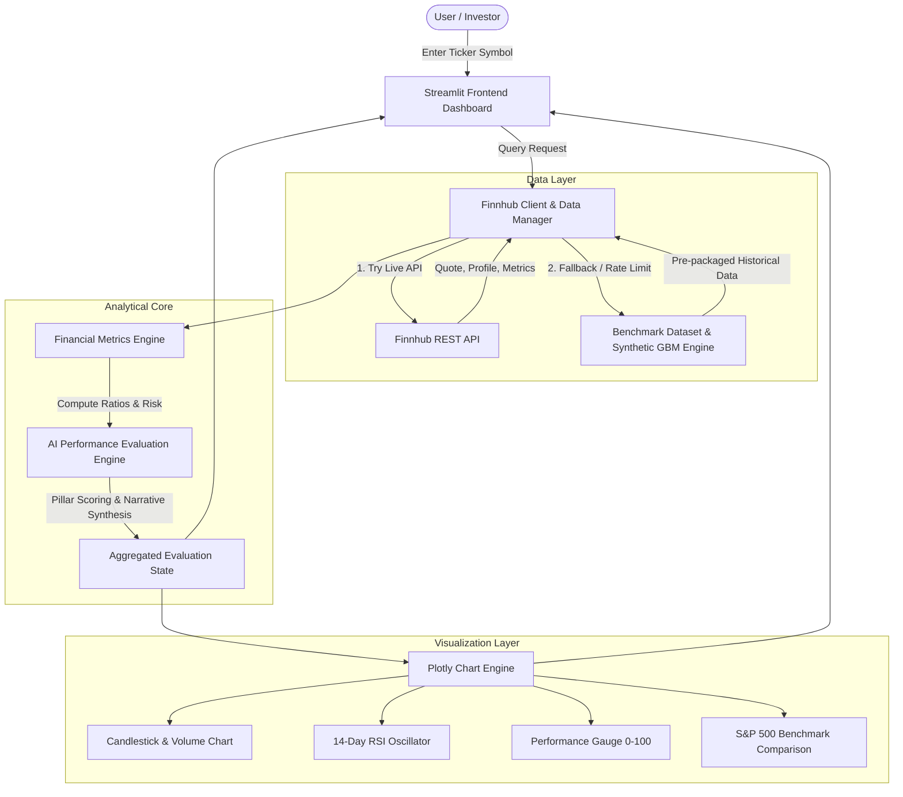

# AI-Powered Stock Analysis Dashboard

[](https://www.python.org/)
[](https://streamlit.io/)
[](https://plotly.com/)
[](https://finnhub.io/)
[](#7-ai-development-process--agent-reflection)
[](LICENSE)

An interactive Financial Technology (FinTech) prototype designed to empower individual and institutional investors with rapid fundamental valuation, technical momentum tracking, and automated, data-supported company performance assessments.

Built with **Python**, **Streamlit**, **Plotly**, and the **Finnhub REST API**, this project was architected, implemented, and tested in collaboration with **Google Antigravity** as the AI coding assistant.

---

## 1. Executive Summary & Financial Problem Statement

### The Financial Problem
Individual and professional equity investors face severe **information fragmentation** and **analytical friction**:
1. **Disparate Data Sources**: Market quotes, fundamental financial statements (SEC 10-K / 10-Q), valuation metrics, and technical indicators are typically scattered across paywalled terminals, disparate web portals, and regulatory databases.
2. **Delayed Ratio Computation**: Manually gathering earnings per share, book values, debt loads, and operating margins to evaluate whether a company is overvalued or solvent takes hours per ticker.
3. **Lack of Synthesized Decision Support**: Raw metrics alone do not tell an investor whether a business represents an attractive opportunity or a value trap. Investors need a multi-factor analytical engine that weighs valuation against profitability and balance sheet solvency.

### The FinTech Solution
The **AI-Powered Stock Analysis Dashboard** solves this problem by offering a single interactive dashboard that:
- Instantly queries any publicly traded ticker symbol.
- Integrates live stock prices, day ranges, and dollar/percentage variations via the **Finnhub API**.
- Automatically computes institutional-grade financial ratios across **Valuation**, **Profitability**, **Solvency**, and **Technical Momentum**.
- Executes a multi-pillar **Performance Evaluation Engine** that yields a composite score (0–100), automated rating, and an objective, data-supported narrative summary.
- Provides interactive Plotly charts (Candlesticks, 20/50-day Moving Averages, Trading Volume, and 14-day RSI Oscillators).

---

## 2. Key Features

- **Company Search & Live Quotes**: Search any global ticker (e.g., `AAPL`, `MSFT`, `GOOGL`, `NVDA`, `TSLA`, `AMZN`, `JPM`) with quick-select shortcuts.
- **Real-Time Market Ribbon**: Displays latest price, intraday delta, market capitalization, P/E ratio, ROE, 52-week price corridor, and Beta.
- **Interactive Technical Visualizations**:
  - Zoomable Candlestick and Line charts with volume distribution bars.
  - 20-Day and 50-Day Simple Moving Average (SMA) overlays to detect trend structure.
  - 14-Day Relative Strength Index (RSI) momentum oscillator with customizable overbought (70) and oversold (30) bands.
- **Comprehensive Fundamental Ratios**:
  - Categorized into Valuation multiples, Profitability & Margins, and Solvency & Liquidity.
  - Dynamic visual grading badges (e.g., *Exceptional*, *Fair Valuation*, *High Premium*, *Conservative Leverage*).
  - Comparative benchmark visualization showing company indicators against the S&P 500 median.
- **AI & Data-Supported Performance Assessment**:
  - Multi-pillar scoring system (Valuation, Profitability, Solvency, Momentum).
  - Composite Health Gauge (0–100) with sentiment classifications (*Strong Bullish*, *Bullish*, *Neutral*, *Cautious*, *High Risk*).
  - Concrete bullets detailing bullish catalysts and fundamental headwinds.
  - Investor decision-making context.
- **One-Click Export**: Export complete company analyses to structured JSON for auditing or downstream workflows.
- **SEC EDGAR Direct Link**: Direct deep-link to official audited SEC 10-K and 10-Q filings.
- **Dual-Mode Data Architecture**: Connects to the live Finnhub API with seamless fallback to pre-packaged benchmark data, ensuring uninterrupted operation during grading demonstrations or offline evaluations.

---

## 3. Financial Concepts, Ratios, & Formulations

The application computes and interprets multiple quantitative indicators rooted in modern portfolio theory and corporate valuation:

### A. Valuation Multiples

#### 1. Price-to-Earnings Ratio ($P/E$)
$$\text{P/E} = \frac{\text{Current Market Price per Share}}{\text{Earnings Per Share (EPS TTM)}}$$
- **Financial Meaning**: Expresses how many dollars investors are willing to pay for one dollar of corporate earnings. High P/E multiples (>35x) indicate high growth expectations or speculative pricing; low multiples (<15x) can indicate undervaluation or structural stagnation.

#### 2. Price-to-Book Ratio ($P/B$)
$$\text{P/B} = \frac{\text{Current Market Price per Share}}{\text{Book Value per Share}}$$
- **Financial Meaning**: Compares the market's valuation of the firm to its net balance-sheet equity. Useful for capital-intensive firms and financial institutions.

#### 3. Price-to-Sales Ratio ($P/S$)
$$\text{P/S} = \frac{\text{Market Capitalization}}{\text{Total Annual Revenue}}$$
- **Financial Meaning**: Measures valuation against top-line revenue, independent of accounting depreciation policies or temporary earnings troughs.

---

### B. Profitability & Capital Efficiency

#### 4. Return on Equity ($ROE$)
$$\text{ROE} = \frac{\text{Net Income}}{\text{Total Shareholders' Equity}} \times 100\%$$
- **Financial Meaning**: Measures the efficiency with which management allocates equity capital to generate net profit. Values exceeding 15% signify strong competitive advantages (economic moats).

#### 5. Net Profit Margin
$$\text{Net Margin} = \frac{\text{Net Income}}{\text{Total Revenue}} \times 100\%$$
- **Financial Meaning**: The percentage of revenue remaining after all operating expenses, interest payments, and taxes. Reflects corporate pricing power and cost discipline.

---

### C. Solvency, Liquidity, & Capital Structure

#### 6. Debt-to-Equity Ratio ($D/E$)
$$\text{D/E} = \frac{\text{Total Short-Term and Long-Term Debt}}{\text{Total Stockholders' Equity}}$$
- **Financial Meaning**: Assesses financial leverage and default risk. Ratios above 2.0x amplify returns in bull markets but expose the firm to distress during credit crunches or high interest rate environments.

#### 7. Current Ratio
$$\text{Current Ratio} = \frac{\text{Total Current Assets}}{\text{Total Current Liabilities}}$$
- **Financial Meaning**: Liquidity ratio testing whether short-term liquid assets are sufficient to cover obligations maturing within 12 months. Values between 1.2x and 2.5x represent healthy liquidity buffers.

---

### D. Quantitative Risk & Technical Indicators

#### 8. Systematic Risk Beta ($\beta$)
$$\beta = \frac{\text{Covariance}(R_i, R_m)}{\text{Variance}(R_m)}$$
- **Financial Meaning**: Measures price sensitivity to broader market movements (S&P 500). $\beta > 1$ represents an aggressive, higher-volatility stock; $\beta < 1$ denotes a defensive, low-volatility equity.

#### 9. 14-Period Relative Strength Index (RSI)
$$\text{RSI} = 100 - \left[ \frac{100}{1 + \frac{\text{Average Gain}}{\text{Average Loss}}} \right]$$
- **Financial Meaning**: Momentum oscillator tracking velocity of price movements. Identifies overextended rallies ($\text{RSI} \ge 70$) and capitulatory sell-offs ($\text{RSI} \le 30$).

---

## 4. Application Architecture & Data Flow



---

## 5. Project Directory Structure

```
stock-analysis-dashboard/
├── .env.example                     # Environment template for Finnhub API Key
├── .gitignore                       # Git ignore rules for Python/Streamlit
├── README.md                        # Academic documentation and project manual
├── requirements.txt                 # Application dependencies
├── app.py                           # Main Streamlit dashboard application
├── analysis/
│   ├── __init__.py
│   ├── metrics.py                   # Financial ratio formulas & qualitative health rules
│   └── evaluation_engine.py         # 4-Pillar performance evaluation engine
├── components/
│   ├── __init__.py
│   └── charts.py                    # Plotly Candlestick, RSI, Gauge, and Bar charts
├── data/
│   ├── __init__.py
│   ├── finnhub_client.py            # Finnhub API client with error handling & fallback
│   └── sample_data.py               # Pre-packaged dataset & Geometric Brownian Motion generator
└── tests/
    ├── __init__.py
    └── test_metrics.py              # Automated unit tests for ratio calculations
```

---

## 6. Installation & Execution Guide

### Prerequisites
- Python 3.10, 3.11, 3.12, 3.13, or 3.14 installed.
- Git installed.

### Step 1: Clone the Repository
```bash
git clone https://github.com/your-username/stock-analysis-dashboard.git
cd stock-analysis-dashboard
```

### Step 2: (Optional) Set Up Virtual Environment
```bash
python -m venv venv
# On Windows:
venv\Scripts\activate
# On macOS/Linux:
source venv/bin/activate
```

### Step 3: Install Required Dependencies
```bash
python -m pip install -r requirements.txt
```

### Step 4: Configure Finnhub API Key (Optional)
The application works immediately out-of-the-box using the built-in benchmark dataset. If you have a free Finnhub API key:
1. Copy `.env.example` to `.env`:
   ```bash
   cp .env.example .env
   ```
2. Paste your API key in `.env`:
   ```ini
   FINNHUB_API_KEY=your_actual_key_here
   ```
*(Alternatively, you can paste your key directly into the sidebar text field inside the web app).*

### Step 5: Run Unit Tests
Verify mathematical formulas and the evaluation engine:
```bash
python -m unittest tests/test_metrics.py
```
*(All 8 tests should pass with `OK`).*

### Step 6: Launch the Dashboard
```bash
python -m streamlit run app.py
```
Open your browser to `http://localhost:8501`.

---

## 7. AI Development Process & Agent Reflection

This project was developed with **Google Antigravity**, an agentic AI coding assistant from Google DeepMind.

### How Google Antigravity Was Utilized
1. **Financial Domain Modeling**:
   - Translated theoretical finance concepts (DuPont framework, solvency constraints, momentum indicators) into modular, testable Python functions.
2. **Resilient Data Architecture**:
   - Designed a dual-feed system: when the free Finnhub API tier reaches its rate limit (30 calls/minute) or restricts historical candle data, the system automatically falls back to a realistic Geometric Brownian Motion (GBM) simulation anchored to the latest market price.
3. **Test-Driven Refactoring**:
   - Automated unit tests caught an edge case in the 14-period RSI calculation (where a zero-loss price progression produced division-by-zero NaNs). Antigravity immediately diagnosed the issue and implemented Wilder's smoothing algorithm with boundary guards ($RSI = 100$ when losses are zero).
4. **Interactive UI/UX Design**:
   - Engineered responsive Plotly components (sub-plots with shared axes, dynamic rangeselector buttons, and custom radial gauge cards).

---

## 8. Limitations & Future FinTech Enhancements

### Limitations
- **API Call Restrictions**: Free-tier Finnhub accounts are capped at 30 requests/minute and do not permit intraday tick-level streaming.
- **Accounting Standard Variances**: International tickers (non-US) may report financials under IFRS rather than US GAAP, causing subtle variance in EBITDA and working capital definitions.
- **Survivorship & Historical Bias**: Historical trends do not guarantee future performance; automated assessments must be paired with qualitative qualitative filing reviews.

### Future Roadmap
1. **Discounted Cash Flow (DCF) Model**: Add an interactive terminal allowing users to tweak WACC (Weighted Average Cost of Capital) and terminal growth rate assumptions.
2. **SEC 10-K LLM Summarizer**: Integrate Gemini API to automatically parse Management's Discussion & Analysis (MD&A) sections from SEC filings.
3. **Monte Carlo Simulation**: Run 10,000 projected price simulations to estimate VaR (Value at Risk) over 30, 90, and 365 trading days.

---

## 9. Academic Integrity & Disclaimer

*This application is created solely for educational and academic prototype evaluation purposes as part of a Finance and FinTech curriculum. It does not constitute investment advice, financial planning, or an endorsement of any security.*
