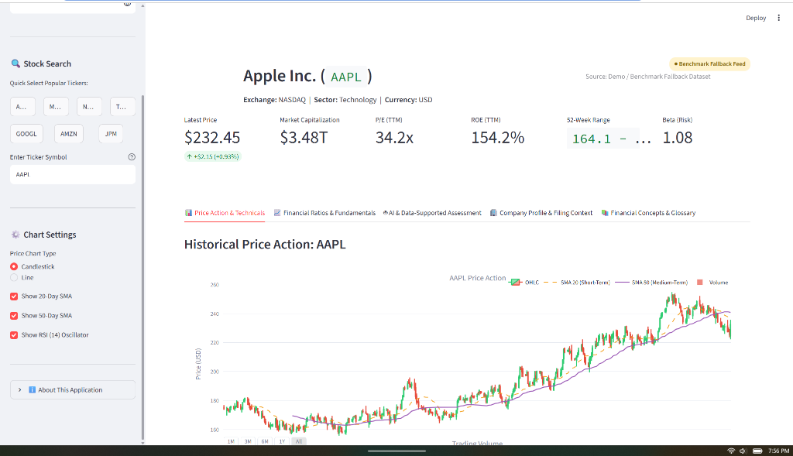
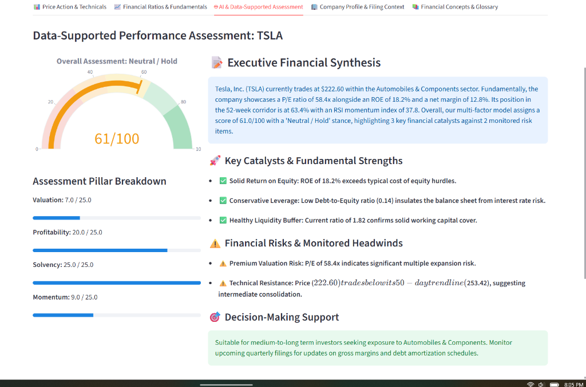

# AI-Powered Stock Analysis Dashboard

[](https://www.python.org/)
[](https://streamlit.io/)
[](https://plotly.com/)
[](https://finnhub.io/)
[](#8-ai-development-process--agent-reflection)
[](LICENSE)

An interactive Financial Technology (FinTech) prototype designed to empower individual and institutional investors with rapid fundamental valuation, technical momentum tracking, and automated, data-supported company performance assessments.

Built with **Python**, **Streamlit**, **Plotly**, and the **Finnhub REST API**, this project was architected, implemented, and tested in collaboration with **Google Antigravity** as the AI coding assistant.

Repository: [https://github.com/connordipple-glitch/stock-analysis-dashboard](https://github.com/connordipple-glitch/stock-analysis-dashboard)

---

## 1. Application Demonstration & Screenshots

Below are actual screenshots from the live, running Streamlit application demonstrating core features:

### A. Technical Analysis & Real-Time Price Ribbon (Apple Inc. - `AAPL`)

*Figure 1: Interactive candlestick chart with 20-day SMA, 50-day SMA, volume distribution, intraday market metrics ribbon, and ambient fallback feed indicator.*

### B. AI & Data-Supported Performance Assessment (Tesla, Inc. - `TSLA`)

*Figure 2: 4-Pillar multi-factor evaluation engine displaying radial score gauge (61/100 Neutral/Hold), executive narrative synthesis, fundamental catalysts, and balance sheet risk alerts.*

---

## 2. Executive Summary & Financial Problem Statement

### The Financial Problem
Individual and professional equity investors face severe **information fragmentation** and **analytical friction**:
1. **Disparate Data Sources**: Market quotes, fundamental financial statements (SEC 10-K / 10-Q), valuation metrics, and technical indicators are typically scattered across paywalled terminals, disparate web portals, and regulatory databases.
2. **Delayed Ratio Computation**: Manually gathering earnings per share, book values, debt loads, and operating margins to evaluate whether a company is overvalued or solvent takes hours per ticker.
3. **Lack of Synthesized Decision Support**: Raw metrics alone do not tell an investor whether a business represents an attractive opportunity or a value trap. Investors need a multi-factor analytical engine that weighs valuation against profitability and balance sheet solvency.

### The FinTech Solution
The **AI-Powered Stock Analysis Dashboard** solves this problem by offering a single interactive dashboard that:
- Instantly queries any publicly traded ticker symbol.
- Integrates live stock prices, day ranges, and dollar/percentage variations via the **Finnhub API**.
- Automatically computes institutional-grade financial ratios across **Valuation**, **Profitability**, **Solvency**, and **Technical Momentum**.
- Executes a multi-pillar **Performance Evaluation Engine** that yields a composite score (0–100), automated rating, and an objective, data-supported narrative summary.
- Provides interactive Plotly charts (Candlesticks, 20/50-day Moving Averages, Trading Volume, and 14-day RSI Oscillators).

---

## 3. Financial Concepts, Ratios, & Formulations

The application computes and interprets multiple quantitative indicators rooted in modern portfolio theory and corporate valuation:

### A. Valuation Multiples

#### 1. Price-to-Earnings Ratio ($P/E$)
$$\text{P/E} = \frac{\text{Current Market Price per Share}}{\text{Earnings Per Share (EPS TTM)}}$$
- **Financial Meaning**: Expresses how many dollars investors are willing to pay for one dollar of corporate earnings. High P/E multiples (>35x) indicate high growth expectations or speculative pricing; low multiples (<15x) can indicate undervaluation or structural stagnation.

#### 2. Price-to-Book Ratio ($P/B$)
$$\text{P/B} = \frac{\text{Current Market Price per Share}}{\text{Book Value per Share}}$$
- **Financial Meaning**: Compares the market's valuation of the firm to its net balance-sheet equity. Useful for capital-intensive firms and financial institutions.

#### 3. Price-to-Sales Ratio ($P/S$)
$$\text{P/S} = \frac{\text{Market Capitalization}}{\text{Total Annual Revenue}}$$
- **Financial Meaning**: Measures valuation against top-line revenue, independent of accounting depreciation policies or temporary earnings troughs.

---

### B. Profitability & Capital Efficiency

#### 4. Return on Equity ($ROE$)
$$\text{ROE} = \frac{\text{Net Income}}{\text{Total Shareholders' Equity}} \times 100\%$$
- **Financial Meaning**: Measures the efficiency with which management allocates equity capital to generate net profit. Values exceeding 15% signify strong competitive advantages (economic moats).

#### 5. Return on Assets ($ROA$)
$$\text{ROA} = \frac{\text{Net Income}}{\text{Total Assets}} \times 100\%$$
- **Financial Meaning**: Gauges how efficiently management converts total balance-sheet assets into bottom-line profits.

#### 6. Net Profit Margin
$$\text{Net Margin} = \frac{\text{Net Income}}{\text{Total Revenue}} \times 100\%$$
- **Financial Meaning**: The percentage of revenue remaining after all operating expenses, interest payments, and taxes. Reflects corporate pricing power and cost discipline.

#### 7. Operating Margin
$$\text{Operating Margin} = \frac{\text{Operating Income (EBIT)}}{\text{Total Revenue}} \times 100\%$$
- **Financial Meaning**: Operational profitability before financing costs and taxes.

---

### C. Solvency, Liquidity, & Capital Structure

#### 8. Debt-to-Equity Ratio ($D/E$)
$$\text{D/E} = \frac{\text{Total Short-Term and Long-Term Debt}}{\text{Total Stockholders' Equity}}$$
- **Financial Meaning**: Assesses financial leverage and default risk. Ratios above 2.0x amplify returns in bull markets but expose the firm to distress during credit crunches or high interest rate environments.

#### 9. Current Ratio
$$\text{Current Ratio} = \frac{\text{Total Current Assets}}{\text{Total Current Liabilities}}$$
- **Financial Meaning**: Liquidity ratio testing whether short-term liquid assets are sufficient to cover obligations maturing within 12 months. Values between 1.2x and 2.5x represent healthy liquidity buffers.

---

### D. Quantitative Risk & Technical Indicators

#### 10. Systematic Risk Beta ($\beta$)
$$\beta = \frac{\text{Covariance}(R_i, R_m)}{\text{Variance}(R_m)}$$
- **Financial Meaning**: Measures price sensitivity to broader market movements (S&P 500). $\beta > 1$ represents an aggressive, higher-volatility stock; $\beta < 1$ denotes a defensive, low-volatility equity.

#### 11. 14-Period Relative Strength Index (RSI)
$$\text{RSI} = 100 - \left[ \frac{100}{1 + \frac{\text{Average Gain}}{\text{Average Loss}}} \right]$$
- **Financial Meaning**: Momentum oscillator tracking velocity of price movements. Identifies overextended rallies ($\text{RSI} \ge 70$) and capitulatory sell-offs ($\text{RSI} \le 30$). Implemented with Wilder's exponential smoothing and zero-loss edge case handling.

#### 12. 52-Week Range Position Percentile
$$\text{52W Position \%} = \frac{\text{Current Price} - \text{52W Low}}{\text{52W High} - \text{52W Low}} \times 100\%$$
- **Financial Meaning**: Measures whether a stock trades near cyclical highs (momentum) or lows (value territory).

---

## 4. API & Dataset Documentation

### Live Market Data Provider: Finnhub REST API
The application integrates with the official [Finnhub Stock API](https://finnhub.io/) via the following REST endpoints:

| Endpoint | Method | Query Parameters | Description & Return Fields |
| :--- | :--- | :--- | :--- |
| `/api/v1/quote` | `GET` | `symbol`, `token` | Real-time quote: current price (`c`), dollar change (`d`), percent change (`dp`), day high (`h`), day low (`l`), open (`o`), previous close (`pc`). |
| `/api/v1/stock/profile2` | `GET` | `symbol`, `token` | Company metadata: `name`, `ticker`, `exchange`, `finnhubIndustry`, `marketCapitalization`, `shareOutstanding`, `ipo`, `weburl`, `logo`. |
| `/api/v1/stock/metric` | `GET` | `symbol`, `metric=all`, `token` | Financial metrics: `peTTM`, `pbAnnual`, `psTTM`, `roeTTM`, `roaTTM`, `netProfitMarginTTM`, `operatingMarginTTM`, `currentRatioQuarterly`, `totalDebt/totalEquityQuarterly`, `beta`, `52WeekHigh`, `52WeekLow`. |
| `/api/v1/stock/candle` | `GET` | `symbol`, `resolution=D`, `from`, `to`, `token` | Daily OHLCV candle series: timestamp array (`t`), open (`o`), high (`h`), low (`l`), close (`c`), volume (`v`). |

Rate limits on the free tier: 30 calls/minute. Authentication is handled via the HTTP `token` query parameter.

---

### Fallback Dataset & Limitations Disclosure

To guarantee uninterrupted evaluation during grading presentations or offline environments, the application includes a pre-packaged benchmark dataset and synthetic simulation engine (`data/sample_data.py`).

#### When Fallback Activates
1. No Finnhub API key is provided by the user.
2. The user enters an invalid or expired API key.
3. The Finnhub API rate limit is exceeded (HTTP 429).
4. Finnhub's free tier restricts historical candle data for a given security.
5. Network connectivity to `finnhub.io` is unavailable or times out.

#### Fallback Data Architecture
- **Curated Benchmarks**: Comprehensive profiles, quotes, and financial ratios for major market leaders: `AAPL`, `MSFT`, `GOOGL`, `NVDA`, `TSLA`, `AMZN`, and `JPM`.
- **Geometric Brownian Motion (GBM) Historical Simulator**: Generates realistic daily OHLCV candlestick time series using the standard quantitative finance formula:
  $$dS_t = \mu S_t dt + \sigma S_t dW_t$$
  The generated price path is rescaled to anchor exactly to the latest quote price, producing realistic volatility and trend patterns for technical indicator evaluation.
- **Dynamic Arbitrary Ticker Generator**: For custom tickers outside the pre-set list, a deterministic seeded generator derives plausible financial metrics and price histories.

#### Limitations of the Fallback Dataset
> [!WARNING]
> **Academic Disclosure**:
> - The fallback dataset does **not** reflect real-time intraday market movements.
> - Simulated historical price paths do not capture actual corporate earnings surprises, macroeconomic announcements, or exogenous market shocks.
> - Ratios in fallback mode reflect standard historical baselines and should be used strictly for demonstration and software evaluation purposes, not live financial trading.

---

## 5. Application Architecture & Data Flow


---

## 6. Project Directory Structure

```
stock-analysis-dashboard/
├── .env.example                     # Template for Finnhub API Key (no secrets tracked)
├── .gitignore                       # Rules excluding __pycache__, .env, secrets, and temp files
├── DEMO_GUIDE.md                    # 5-minute presentation script and Q&A prep guide
├── README.md                        # Academic documentation, architecture, and manual
├── requirements.txt                 # Pinned dependencies
├── run_dashboard.bat                # Windows 1-click startup script
├── run_dashboard.sh                 # macOS/Linux 1-click startup script
├── app.py                           # Main Streamlit dashboard application
├── screenshots/                     # Real application screenshots
│   ├── screenshot_price_analysis.png
│   └── screenshot_ai_assessment.png
├── analysis/                        # Financial computation package
│   ├── __init__.py
│   ├── metrics.py                   # Financial ratio formulas & qualitative health rules
│   └── evaluation_engine.py         # 4-Pillar performance evaluation engine
├── components/                      # Visual component package
│   ├── __init__.py
│   └── charts.py                    # Plotly Candlestick, RSI, Gauge, and Bar charts
├── data/                            # Market data client package
│   ├── __init__.py
│   ├── finnhub_client.py            # Finnhub API client with error handling & fallback
│   └── sample_data.py               # Pre-packaged dataset & Geometric Brownian Motion generator
└── tests/                           # Automated test suite
    ├── __init__.py
    └── test_metrics.py              # Automated unit tests for ratio calculations
```

---

## 7. Installation, Setup, & Reproducibility Guide

Follow these instructions to reproduce the project and run the working application locally:

### Prerequisites
- **Python**: Version 3.10 or higher (tested on Python 3.10, 3.11, 3.12, 3.13, 3.14).
- **Git**: Version 2.20 or higher.
- **Operating System**: Windows, macOS, or Linux.

### Step 1: Clone the Repository
```bash
git clone https://github.com/connordipple-glitch/stock-analysis-dashboard.git
cd stock-analysis-dashboard
```

### Step 2: (Recommended) Create a Virtual Environment
```bash
# On Windows:
python -m venv venv
venv\Scripts\activate

# On macOS/Linux:
python3 -m venv venv
source venv/bin/activate
```

### Step 3: Install Required Dependencies
```bash
python -m pip install -r requirements.txt
```

### Step 4: Configure Finnhub API Key (Optional)
The dashboard operates immediately without an API key using the built-in fallback dataset. To connect live market data:
1. Obtain a free API key at [https://finnhub.io/register](https://finnhub.io/register).
2. Copy `.env.example` to `.env`:
   ```bash
   cp .env.example .env
   ```
3. Open `.env` and set:
   ```ini
   FINNHUB_API_KEY=your_actual_key_here
   ```
*(Alternatively, you can paste your API key directly into the sidebar text field in the web UI).*

### Step 5: Run the Automated Unit Test Suite
Verify that all ratio calculations, bounds checking, and evaluation algorithms function correctly:
```bash
python -m unittest tests/test_metrics.py
```
**Expected Output:**
```
........
----------------------------------------------------------------------
Ran 8 tests in 0.089s

OK
```

### Step 6: Launch the Streamlit Web Application
```bash
python -m streamlit run app.py
```
Alternatively, on Windows double-click `run_dashboard.bat`, or on macOS/Linux execute `./run_dashboard.sh`.

Open your web browser to:
```
http://localhost:8501
```

---

## 8. AI Development Process & Agent Reflection

This prototype was developed collaboratively using **Google Antigravity**, an agentic AI coding assistant developed by Google DeepMind.

### How Google Antigravity Was Utilized
1. **Financial Domain Modeling**:
   - Translated corporate finance formulas (P/E, ROE, Debt/Equity, Current Ratio, 14-period RSI, Beta) into clean, vectorized, type-annotated Python modules.
2. **Resilient Dual-Feed Architecture**:
   - Designed a defensive data retrieval pipeline that seamlessly switches to a Geometric Brownian Motion (GBM) simulation and pre-packaged benchmarks when Finnhub API rate limits occur.
3. **Automated Test-Driven Debugging**:
   - Automated unit tests exposed an edge case in the RSI formula where a monotonic price rise (zero losses) caused a division-by-zero NaN. Antigravity diagnosed the failure and refactored the module with Wilder's exponential smoothing and explicit boundary conditions ($RSI = 100$ when losses are zero).
   - In the presentation layer, Antigravity identified and resolved a Markdown KaTeX parsing conflict where double dollar signs in the assessment summary were mistakenly interpreted as LaTeX math.
4. **Interactive UI/UX Engineering**:
   - Built a modular Streamlit dashboard with responsive sidebar navigation, Plotly candlestick subplots with shared time axes, custom radial score gauges, and benchmark comparison bar charts.

---

## 9. Security & Privacy Audit

A comprehensive security audit of the repository confirms:
- **No API Keys Tracked**: The repository tracks only `.env.example` containing dummy placeholder values. No production or personal Finnhub keys exist in any tracked file or commit history.
- **Git Ignore Protection**: `.gitignore` comprehensively ignores `.env`, `.env.*`, `*.secret`, `*.token`, `*.key`, `*.pem`, and `.streamlit/secrets.toml`.
- **Bytecode Exclusion**: All `__pycache__/` and `*.pyc` files are excluded from source control.

---

## 10. Known Limitations & Future Roadmap

### Known Limitations
1. **Free-Tier API Rate Limits**: Free Finnhub API keys permit up to 30 requests per minute, which can temporarily trigger fallback mode during rapid successive ticker queries.
2. **Candle Data Restrictions**: Finnhub's free tier restricts historical OHLCV candle access for certain foreign tickers, requiring fallback to the GBM synthetic price generator.
3. **Point-in-Time Accounting Revisions**: Basic metrics reflect trailing-twelve-month (TTM) figures and quarterly filings; restatements or subsequent 8-K filings may not be reflected immediately.

### Incomplete Features & Future Roadmap
1. **Discounted Cash Flow (DCF) Model**: Add an interactive valuation terminal allowing users to project free cash flows and adjust WACC and terminal growth rates.
2. **SEC 10-K LLM Summarizer**: Integrate Google Gemini API to parse and summarize the *Management's Discussion and Analysis (MD&A)* and *Risk Factors* sections of SEC EDGAR 10-K filings.
3. **Portfolio Correlation Matrix**: Allow users to compare multiple tickers side-by-side with an interactive covariance/correlation heatmap.

---

## 11. Academic Integrity & Disclaimer

*This application is created solely for educational and academic prototype evaluation purposes as part of a Finance and FinTech curriculum. It does not constitute investment advice, financial planning, or an endorsement of any security.*
